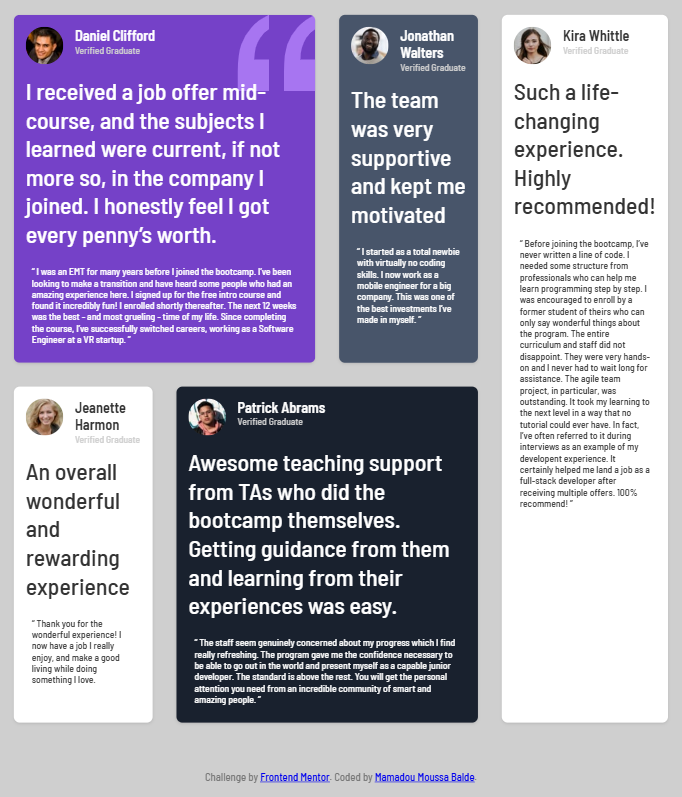
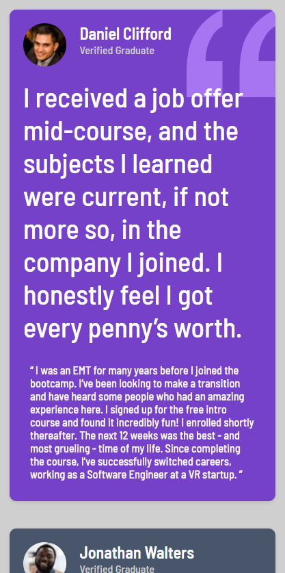

# Testimonials Grid

## By [Mamadou Moussa Balde](https://www.linkedin.com/in/2mb/)

A static testimonials page for five Frontend Mentor graduates. The browser tab title is **Frontend Mentor | Mamadou Moussa Balde**. The font is Barlow Semi Condensed. The page background is grey, `hsl(0, 0%, 81%)`.

There is no script. The layout is CSS grid.

## Screenshots

**Wider than 800px.** Daniel spans two columns. Jonathan sits beside him. Kira is the tall card on the right and spans both rows. Jeanette is under Daniel. Patrick spans the two columns under Jonathan. Daniel’s card shows the quotation graphic in the top right corner.



**375px wide.** The grid becomes one column. The cards stack in the order they appear in the HTML: Daniel, Jonathan, Jeanette, Patrick, then Kira.



## The cards

Each card has a round photo, a name, the line “Verified Graduate”, a large headline, and a quote. The photos are 56px images shown at 50px. Headlines are `2rem` (32px). “Verified Graduate” is grey `hsl(0, 0%, 81%)` on every card, including the white ones, so that line is faint on Jeanette’s card and on Kira’s card.

| Person | Card | Headline |
| --- | --- | --- |
| Daniel Clifford | Purple `hsl(263, 55%, 52%)` | I received a job offer mid-course, and the subjects I learned were current, if not more so, in the company I joined. I honestly feel I got every penny’s worth. |
| Jonathan Walters | Grey `hsl(217, 19%, 35%)` | The team was very supportive and kept me motivated |
| Jeanette Harmon | White | An overall wonderful and rewarding experience |
| Patrick Abrams | Dark blue `hsl(219, 29%, 14%)` | Awesome teaching support from TAs who did the bootcamp themselves. Getting guidance from them and learning from their experiences was easy. |
| Kira Whittle | White | Such a life-changing experience. Highly recommended! |

Jeanette’s quote opens with a quotation mark and does not close it. It ends at “something I love.” Kira’s quote spells the word “developent” in the sentence about interview examples.

## Footer

```text
Challenge by Frontend Mentor. Coded by Mamadou Moussa Balde.
```

Frontend Mentor links to `https://www.frontendmentor.io?ref=challenge`. The name link is `href="#"`, so it stays on this page. The stylesheet does not set a color for those links.

## How to open it

Open `index.html` in a browser, or serve this folder:

```bash
python -m http.server
```

The four-column grid is used when the window is wider than 800px. At 800px and below, every card uses one column and the row and column placements are cleared.
